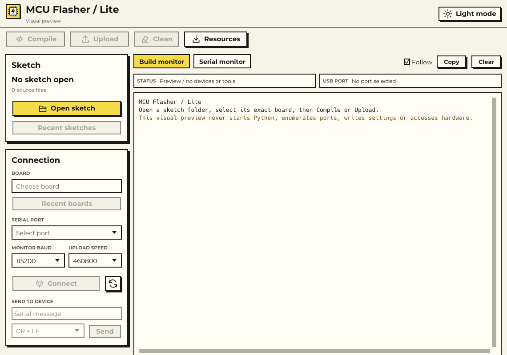

# MCU Flasher / Lite

A separate Rust desktop workbench with the main MCU Flasher's Python build and
device tools. All Lite source, launchers, assets and documentation belong to this
folder. The main GUI/build logic and your original sketch files stay unchanged. Shared
Bootstrap/release inventory code includes Lite and future public source files automatically.



## Open Lite

- **Ubuntu:** double-click the executable `UBUNTU`, or run `./LITE-MODE/run.sh`.
- **Windows:** double-click `WINDOWS.exe`. `WINDOWS.cmd` is the build-and-launch
  fallback when the executable has not been built.

Keep `LITE-MODE` inside the main project's folder, beside `main/` and `src/`.
The launchers find their tools relative to themselves, so the complete project
can be moved. This checkout supplies Ubuntu x64 and Windows x64 executables.
Ubuntu ARM64 requires a native build, which produces `UBUNTU_ARM64`.

Lite first uses its own `.venv` if one exists, then borrows the main project's
prepared private Python interpreter **without installing or modifying anything
in that interpreter**. If neither is available, install Lite's tool dependencies:

```sh
# Ubuntu, Python 3.11+ with venv available
python3 LITE-MODE/tools/setup.py
```

```bat
rem Windows, from LITE-MODE
py -3 tools\setup.py
```

The Rust GUI does not need Python GUI rendering or Qt WebEngine. The headless
backend still uses Qt Core through PySide6 Essentials. Runtime setup installs
only into `LITE-MODE/.venv`. Rust is needed to rebuild, not to use the supplied
native executables.

## Workbench

1. **Open sketch** selects a folder containing saved `.ino`, `.cpp` or `.c` files
   at its root. You can also drop a folder or source file into the workspace.
   Edit in your usual editor and save before building. **Recent sketches** and
   the Open sketch dialog retain your 10 most recently opened folders.
   Click a source filename, such as `MySketch.ino`, to open its original sketch
   directory in Ubuntu Files or Windows Explorer. File-manager launch errors
   appear in Lite; the link never opens the private build snapshot.
2. **Board** searches the bundled official PlatformIO catalog by board name,
   ID, vendor, platform, MCU or framework. Multiple words match across these
   fields; exact names/IDs rank first, and misspellings offer labeled closest
   matches. **Recent boards** retains the last 5 selections. Select the exact
   board and one of its declared frameworks. No board or port is automatically
   chosen. Both histories persist in Lite's private settings.
3. **Compile and Upload prepare their tools automatically.** Lite first keeps
   matching tools already installed in its store, then reuses compatible packages
   prepared by the main app. Only missing requirements are downloaded. The check
   includes optional uploaders such as `tool-avrdude`, as well as the selected
   platform, framework, compiler and SCons. No separate Prepare click is needed.
   **Resources > Boards > Prepare selected board** remains an optional way to
   prepare in advance. **Resources > Libraries** searches the PlatformIO registry
   and installs the displayed version into Lite's own store.
4. **Compile**, **Upload** and **Clean** call the existing backend actions.
   Compile is enabled only with a sketch and configured board/framework. Upload
   additionally requires a selected, currently connected serial port. The worker
   checks readiness again before preparing tools and before dispatching.
   Root sources are captured again before Compile and Upload. Incremental builds,
   source/output verification, complete upload images and restart checks remain
   owned by the main backend. Clean affects Lite's build state and compiled-file
   cache, retaining packages, original sources, settings and recovery history.
   Each sketch retains separate exact-board/framework build workspaces. Upload
   automatically skips compilation when that board's saved source, configuration,
   dependencies and firmware bytes still verify. Switching back to a previously
   compiled board can reuse its own build. Changed or missing outputs and Clean
   require compilation again. There is no Skip Compile checkbox.
5. **Build monitor** shows action output. **Serial monitor** shows device output;
   **Connection** contains port selection, baud, Connect/Disconnect, sending and
   CR/LF controls. Selecting a
   port does not open it; Connect uses the main app's passive serial connection.
   Baud changes request no reset. Upload retains the backend's monitor handoff.

The header's **Light mode / Dark mode** button names the active theme and changes the complete interface,
including monitor colors and dialogs. Light is the default at every launch.
Theme changes retain selections, logs and scroll positions. Status and USB port
details have separate bordered containers. The compact header and controls leave
the remaining height to the monitor; there are no promotional banners or footer.
Colors have one meaning each: yellow marks primary actions (Compile, Upload,
Open sketch, Connect) and the selected tab, coral marks Stop, Disconnect and
errors, and everything else uses the same paper surface and ink outline. Fields
and menus share one style and highlight on hover in both themes.

**Developer Access:** click the logo exactly five times, with less than 800 ms
between clicks, then pause. This opens the main application's existing ticket
portal in an owned helper window; another gesture brings that window forward.
The normal account/local-key authentication remains required. Lite keeps local
portal data and saved credentials in its own namespace, while using the same
built-in cloud provider and account rules. The main workspace is not launched.

Both monitors have Follow, Copy and display-only Clear controls, selectable
output, separate histories and a bounded 4,000-line view. Only visible log rows
are drawn. Fixed row heights, a fixed viewport and reserved scrollbars keep output
steady as long or partial lines arrive and when switching monitors. Stop follows
the original backend's write protection; closing Lite
is held while a command, compilation, download or firmware operation is active.
There is deliberately no editor, assistant, cloud session or Reset action.
Uploader and download progress updates replace their own activity row. Completed
warnings/errors remain in history, and decorative-mark removal preserves table
columns. A successful "Written and verified" upload remains a success report.

Preparation runs in a worker while the interface remains responsive. Stop during
preparation prevents the pending action from starting. A preparation failure
does not attempt or replay an upload. Once tools are ready, the original backend
receives the requested action exactly once and retains its flash-write guards.

## Isolation

Each worker refreshes a private byte-for-byte copy of the main Python source.
Build logic is reused, not independently rewritten. Lite never imports the main
workspace GUI or starts its editor/assistant services. Backend source updates
are picked up on the next Lite launch.

Default writable state is separate from both the main app and original sketches:

| Host | Lite state |
| --- | --- |
| Ubuntu | `${XDG_DATA_HOME:-~/.local/share}/mcu-flasher-lite` |
| Windows | `%LOCALAPPDATA%\mcu-flasher-lite` |

That directory owns the backend snapshot, settings, staged sketches, downloads,
packages and caches. Original root sources are read only; protected original
cache/journal trees are not copied. The optional `MCU_LITE_STATE` override must be
absolute. `MCU_LITE_PYTHON` can name a compatible interpreter, and `MCU_LITE_ROOT`
can explicitly locate this folder. No override is necessary for ordinary use.
One Lite workspace at a time owns the native state lock. This is separate from
the original app's own workspace lock; avoid using both apps on the same physical
serial port at once.

For tool reuse, Lite finds the main app's native PlatformIO store before changing
its own environment: the main copy's `src/.platformio-mcu-gui` on Windows and
`${XDG_DATA_HOME:-~/.local/share}/mcu-flasher/platformio/<architecture>` on Ubuntu.
It accepts only matching package identity, version and host metadata. Reused
packages are independent private copies verified against the source bytes; the
main store is read only. Existing incompatible versions are not silently adopted.
Copy progress appears as `Package files:` in the Build monitor. Interrupted reuse
stages stay outside installed package directories, so a partial copy cannot be
mistaken for an installed uploader. Successful reuse requires no network access.

Windows keeps any short-path junctions under its dedicated
`<drive>:\.mcu-flasher-lite\<state-hash>` namespace (or within Lite state when
drive-root creation is unavailable). It never repoints the main app's junctions,
cleans its legacy aliases or changes the user's global PlatformIO configuration.

Source capture is root-only, refuses linked sources, and is bounded to 128 files
and 8 MiB total. This version does not copy nested source/library trees or adopt
an original project's `platformio.ini`. Libraries belong in Resources. These
limits keep source ownership explicit and protect original application files.

## Build and verify

```sh
python3 LITE-MODE/tools/build.py
cargo check --locked --manifest-path LITE-MODE/Cargo.toml
cargo clippy --locked --all-targets --manifest-path LITE-MODE/Cargo.toml -- -D warnings
cargo test --locked --manifest-path LITE-MODE/Cargo.toml
.venv-linux/bin/python -B LITE-MODE/tools/verify.py
.venv-linux/bin/python -B LITE-MODE/tools/verify_preparation.py
.venv-linux/bin/python -B LITE-MODE/tools/verify_history_search.py
.venv-linux/bin/python -B LITE-MODE/tools/verify_developer.py
```

On Windows, use `py -3 tools\build.py` from this folder and run `tools\verify.py`
with the private Python interpreter. Builds are standalone Cargo workspaces and
do not change the existing `desktop/` Rust migration.

For a portable Ubuntu binary with a glibc 2.39 floor, build using an Ubuntu 24.04
host or `cargo zigbuild --release --locked --target x86_64-unknown-linux-gnu.2.39`.
An ordinary build on a newer distro can require its newer glibc. The supplied
`UBUNTU` was linked with the 2.39 floor.

The hardware-free verifier mocks port enumeration and checks source capture,
backend action delegation, serial control behavior, settings isolation, Python
child startup and real Clean on disposable fixtures. An additional **opt-in**
compiler check downloads only into its own `temp/compile-proof` fixture:

```sh
.venv-linux/bin/python -B LITE-MODE/tools/qualify_compile.py --prepare
```

Alternatively, `--reuse-main` reuses compatible main-app packages in that owned
fixture. Automatic preparation also runs when no explicit `--prepare` is given.
The check builds a synthetic Uno sketch, repeats an unchanged build, changes the
source and verifies that framework objects are retained. It compiles a Nano into
a separate workspace, returns to each board and verifies automatic reuse. Source
edits, firmware corruption and Clean must reject reuse. It checks the optional
AVR uploader, constructs the real offline uploader recipe with serial opens
refused, and mocks the final device boundary to verify each Upload handoff. These are
tool/compiler checks; no physical upload is performed.

`./LITE-MODE/UBUNTU --preview` opens a visual preview without starting Python,
reading settings, enumerating ports or touching hardware. The capture options
`--capture PATH`, `--preview-size 700x560`, `--preview-serial` and
`--preview-resources` support isolated virtual-display layout checks.
`--preview-recents` adds explicitly synthetic history paths for previewing the
`--preview-projects` and `--preview-boards` dialogs.
`--preview-dark` captures the alternate palette without changing the launch default.
`--preview-sketch` displays synthetic filenames for checking the folder-link UI.

## Platform evidence

Target scope is native Ubuntu 24.04+ (x64/ARM64) and Windows 10/11 x64, with a
working OpenGL driver and the main backend's four-core resource floor. Other
operating systems and Windows ARM64 are refused by the worker before setup.

Local evidence covers Ubuntu 26.04.1 x64, isolated X11/software-rendered GUI,
strict Rust linting, hardware-free integration and real incremental AVR builds.
The Windows executable is cross-compiled with its dedicated icon and GUI
subsystem; execution on native Windows remains pending. Native Ubuntu 24.04,
Ubuntu ARM64, Wayland interaction, physical USB upload/restart and serial driver
qualification remain pending. See [VERIFICATION.md](VERIFICATION.md).

## Bootstrap and releases

Lite is included in the public ZIP and Ubuntu per-user Bootstrap installation.
Git checkouts copy tracked application files; public ZIPs carry a generated
`.mcu-flasher-sources.json`. New committed application folders/files enter both
without another folder-list edit. Private state, runtimes, caches and development
scratch stay outside that inventory; older ZIPs retain a reviewed fallback.
The main source updater already accepts new tracked application paths.
