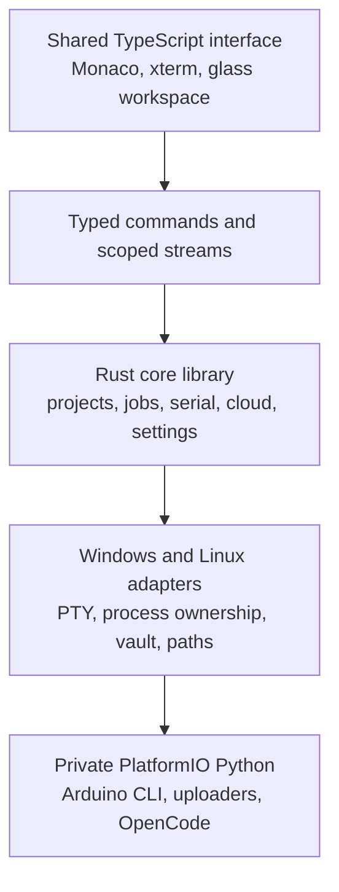

# MCU Flasher: Rust and Tauri transition proposal

> **20 October 2026 requirement amendment:** The user requires a native Rust
> widget GUI and a Rust application backend, retaining Monaco and xterm as
> embedded components. This supersedes the TypeScript application-shell design
> below. Preserve the existing Rust core/host/contracts and prototype evidence;
> qualify a native widget/child-WebView shell before toolkit commitment. Python
> remains only for approved private firmware tools, never the replacement GUI
> or application backend. See [the native Rust execution plan](../audit/migration/NATIVE_RUST_PLAN.md).

Date: 18 October 2026; checkpoint updated 19 October 2026
Status: Implementation in progress at `4cf730b`; fixture prototype, narrow core ports and isolated native registration proofs.
Reference implementation: commit `1d00ff0`, plus an inventory of any subsequent approved fixes.
Context: [shared architecture discussion](https://chatgpt.com/share/6ad49eff-94d0-83ec-98da-c601dbd68c9a).

## 1. Decisions and remaining questions

Confirmed by the user:

- Develop primarily on Ubuntu; use one shared Rust/Tauri 2 codebase.
- Require Windows 10 and Windows 11 AMD64, Ubuntu AMD64, and Ubuntu ARM64.
- Retain the Ubuntu 24.04-or-newer admission policy. Explicitly test 24.04 and 26.04; newer releases become verified individually.
- Reach full current feature parity before replacing the Python application. Internal previews may be incomplete, but cannot become the replacement release.
- Retain the current workflow and glass appearance, improving consistency and responsiveness.
- Keep the existing Firebase deployment, accounts, and cloud sketch format compatible.
- Support online first setup, followed by offline work with prepared toolchains.
- Remove Python from application services while retaining private Python for PlatformIO and firmware tools.
- Prioritize a Windows installer and Ubuntu DEB packages; validate portable distributions later.
- Use the existing codebase as the source of truth. Maximize reuse of assets, configurations, supported targets, and proven logic; justify each replacement.
- Treat compilation success as build evidence only. Native GUI, toolchain, serial, and USB tests determine verified compatibility.

All initial planning questions have answers. Details to confirm before native hardware testing are the Windows PC's OS/build and USB access, the Nano revision/bootloader, and the ESP8266 board model. These are test prerequisites rather than permission to reduce compatibility.

Initial physical test inventory: ESP32-WROOM-32 38-pin development board, Uno R3/ATmega328P, Arduino Nano (revision pending), and an ESP8266 development board (model pending). Use onboard USB programming interfaces where present; no dedicated external programmer is confirmed. Never infer an exact target/bootloader from a module name or pin count alone.

## 2. Recommendation

Use a staged replacement alongside the existing application. Keep the working Python release available throughout development and retire each application service only after its replacement passes the corresponding behavior checks.

The target is a Rust application, an HTML/CSS/TypeScript interface, and the existing Monaco/xterm assets with new host adapters. PlatformIO, Arduino CLI, uploaders, and OpenCode remain external tools. PlatformIO still requires Python; changing the desktop language does not remove that dependency. [PlatformIO requirements](https://docs.platformio.org/en/latest/core/installation/requirements.html).

Do not translate Python files line by line or change firmware build systems during the UI migration. Preserve the exact-target, offline, recovery, and process-ownership behavior already implemented.

The [reuse inventory](rust-tauri-reuse-inventory.md) records the initial source analysis and required component dispositions. Current implementation and evidence live in [the durable audit](../audit/migration/STATUS.md). A structural inventory alone does not complete the behavior audit: remaining call-path, failure and performance baselines must be recorded before broad replacement or retiring any Python service.

## 3. Target architecture



| Layer | Responsibility |
| --- | --- |
| Frontend | Layout, local editor models, user input, accessible controls, virtual lists, and bounded display histories. |
| Tauri boundary | Validate window/workspace ownership, decode typed requests, authorize operations, and deliver scoped responses. |
| GUI-independent Rust core | Workspace revisions, project transactions, settings, job state machines, resource budgets, serial ownership, cloud coordination, and tool orchestration. |
| Host adapters | Windows ConPTY/process jobs/credentials/driver integration; Linux PTYs/process groups/secure storage/USB permissions; native path handling on each. |
| External tools | Run certified native tool versions with explicit arguments, controlled environment, and the existing offline/build policy. |

Implementation source layout:

```text
desktop/
  ui/                  TypeScript, CSS, Monaco and xterm host adapters
  src-tauri/           Desktop setup, windows, commands and permissions
  crates/
    core/              GUI-independent application services
    host/              Windows/Linux implementations behind shared interfaces
    contracts/         Versioned messages and public error types
  scripts/             Asset staging and hardware-free parity harnesses
audit/migration/        Durable status, inventory, evidence and restart handoff
  scratch/             Disposable runtime fixtures (ignored by Git)
```

Use TypeScript with a small build pipeline; choose and pin any UI framework after the prototype demonstrates acceptable editor lifecycle and performance. Frontend build tooling does not become a general end-user runtime dependency.

Use commands for request/response operations, ordered channels for terminal/serial/build streams, and small scoped events for status. Add application-level byte acknowledgements, bounded queues, cancellation, and workspace/revision identifiers. Tauri channels support ordered streaming, but do not replace these ownership and backpressure rules. [Tauri communication guidance](https://v2.tauri.app/develop/calling-frontend/).

## 4. Current code to preserve or replace

| Existing area | Transition treatment |
| --- | --- |
| `src/editor/index.html`, `project_files.js`, workers, fonts and Monaco bundle | Reuse assets and behavior initially. Replace `QWebChannel`/`pywebview` host calls through an explicit TypeScript adapter. |
| `src/editor/terminal.html`, xterm assets and OpenCode views | Retain rendering behavior; replace Qt bridges and Python PTY controllers with Rust-backed transport. |
| `main/web_bridge.py`, `main/qt/signals.py` | Extract contracts and state transitions, then replace orchestration with Rust services. |
| `main/core/`, `main/platforms/` | Port by service with fixtures covering outputs, failures, cancellation, and ownership. Preserve separate native implementations where required. |
| `src/modules/arduino_lib_req.py`, Tk glass modules, Qt panels | Rebuild screens in the shared frontend. Retain workflows, palette tokens, callbacks, extraction behavior, and performance budgets rather than Tk/Qt paint internals. |
| Bootstrap, package jobs, offline guards and tool preparation | Keep existing workers temporarily behind narrow adapters while Rust replacements gain equivalent validation and locking. |
| Firebase provider, cloud service and credential store | Keep deployment and data semantics; port authentication, conflict handling, and secure storage without adding editable provider settings. |
| `direct/verify_*.py`, JavaScript checks and CI | Treat as behavior specifications. Keep legacy verification while adding Rust, frontend, contract, and native desktop equivalents. |

The currently checked-in preparation plan includes AVR, ESP32, and ESP8266 Arduino platforms. That is not the complete application's feature or board-coverage inventory; Phase 0 must also capture supported custom targets, additional frameworks, and explicit Arduino CLI routing.

## 5. Delivery phases and gates

### Phase 0 — Record the parity contract

- Thoroughly inspect the current GUI, backend, bridge, build/upload flows, serial/PTY services, bootstrap, resources, and configuration ownership before architectural changes. Extend the initial dependency inventory with traced call paths and error behavior.
- Classify each component as reuse unchanged, retain with a new host adapter, preserve as tool-runtime code, or port with equivalent behavior. Every port must explain why direct reuse is unsuitable and name its original implementation and verification cases.
- Inventory every screen, action, shortcut, setting, backend operation, and supported target/framework/transport combination.
- Record relevant existing verifiers and reproducible baseline captures, including default, light, and Solarized themes.
- Measure startup-to-interactive, process-tree memory, idle CPU, search/scroll latency, resize responsiveness, serial/terminal throughput, and large-project opening on representative four/six-core machines and the Pi 5.
- Capture schemas and sanitized examples for settings, source manifests, notifications, package jobs, cloud links, and recovery metadata.
- Create a compatibility ledger with separate build, launch, GUI, compile, serial, upload, installation, and recovery results.

**Exit:** the reuse ledger and behavior audit cover every existing capability with an owner, acceptance scenario, dependencies, and required host coverage. No component is slated for a rewrite without a documented reason. Set measurable performance thresholds from the baseline before implementation expands. Do not promise lower total memory merely from using Rust.

### Phase 1 — Prove the highest-risk integrations

Build a disposable Tauri prototype that loads bundled Monaco and xterm, opens fixture sources, saves through a Rust command, and streams a controlled child process.

Validate WebView2 on Windows and WebKitGTK on Ubuntu, including ARM64, workers, CSP/asset loading, fonts, input methods, clipboard, shortcuts, file dialogs, fractional scaling, and mixed-monitor moves. Tauri's webview prerequisites differ by host. [Tauri prerequisites](https://v2.tauri.app/start/prerequisites/).

Prove editor detach/reattach, dirty buffers, view state, and undo/redo history early. The current Qt application reparents one editor; separate Tauri webviews cannot be assumed to share its live JavaScript model. Select an approach only after demonstrating parity using supported APIs. If that cannot be achieved, record it as an architectural blocker rather than silently losing state. Monaco documents models as the holders of edit history and treats APIs outside its public declarations as private. [Monaco integration reference](https://github.com/microsoft/monaco-editor).

Probe native PTY behavior and serial discovery; hardware writes require explicit test sessions on identified boards. Missing Windows access leaves its gate pending.

Exercise representative builds in disposable host-native tool stores early, including the Pi 5. Preserve existing PlatformIO-integrated Python hooks where they are part of the firmware tool runtime; a Rust frontend must not accidentally bypass those guards or compatibility fixes.

**Exit:** packaged prototype evidence on each required host class, with explicit blockers for unavailable machines. Do not begin broad UI replacement until editor/window and terminal feasibility are established.

### Phase 2 — Establish the core and migration boundary

- Define typed workspace, document, operation, session, and revision identities.
- Implement narrow commands, structured errors, cancellation, bounded transport, path containment, and cross-window ownership.
- Add a headless core harness for fixture-driven service verification.
- Introduce settings/import readers and a new application-state namespace with rollback.
- Where necessary, supervise existing Python workers through a versioned, local, bounded protocol. Give them explicit operations rather than a generic evaluation endpoint.
- Keep exactly one owner for serial ports, package mutations, project writes, and hardware jobs, including coexistence with the old release. If legacy ownership cannot interoperate safely, refuse concurrent access.

**Exit:** service contracts and failure behavior pass without the GUI; the prototype cannot affect another workspace through a forged request.

Current bounded implementation: pure legacy liveness/project/port claim plans,
native process creation-time evidence and disposable locked registration
transactions are implemented. Their checks retain unknown claims and fields,
detect competing native/Python owners and preserve concurrent Python updates.
The registry keeps untouched metadata as private validated JSON fragments, so
large Python integers and nested marker-shaped objects avoid generic Value
conversion. The private fragment representation does not require a direct
`raw_value` feature declaration. Known creation timestamps use `float_roundtrip`;
Tauri's transitive feature means unknown native metadata must remain opaque.
Local `4cf730b` checks pass 90 Rust tests (21 registry tests), 40 frontend tests,
46 native webview checks and 23,909 pure cases, including 1,335 preference cases.
Separate native proofs pass eight lock, six process and nine registration checks.
They do not connect the production project service to live settings or establish
a source-save lease. Native filesystem identity, activation rollback and shared
package-store/event-root coordination remain prerequisites for live ownership.
The PID-keyed schema still represents one workspace per process; multiple
independent workspaces in one Tauri process require a coordinated schema decision.

### Phase 3 — Deliver project and editor parity

- Existing/new/recent/cloud project entry, independent workspaces, and selector disposal after successful activation.
- All supported source tabs, ordering, dirty flags, file search, syntax results, save acknowledgement, reload, recovery, and editor detach/reattach.
- Modify add/delete/rename refreshes only affected editor/project state; terminal/assistant sessions and hardware selections survive.
- New-project header selection adds the appropriate quoted include to generated sketch/source files.
- AI receives updated source manifests and revisions while recovery history retains its existing semantics.

**Exit:** project lifecycle fixtures pass through multiple windows, renderer failure, conflicting external edits, permission failures, and slow/coarse-timestamp storage.

### Phase 4 — Deliver device, build, terminal and assistant parity

- Exact board/framework/transport selection, compatibility information, syntax, compile, upload, and existing reset/recovery actions.
- Preserve save-before-build, exact-board cache receipts, source-byte checks, installed-only build policy, resource budgets, package leases, and interrupted-job handling.
- Implement serial monitoring/sending, baud and line-ending choices, disconnect recovery, and upload-time serial ownership.
- Replace temporary Python application controllers for terminals and OpenCode with native Rust ownership and host adapters. Preserve Unicode, capability replies, bracketed paste, clear-as-display-only, hide/reveal, and bounded recovery without replaying commands.

**Exit:** mock fault/cancellation cases pass, and actual compile/upload evidence is recorded for agreed exact targets on each host. A port name alone is not device or board proof.

### Phase 5 — Complete resources, cloud, setup and auxiliary UI

- Downloader libraries/boards/installed workflows, checksums, safe extraction, cancellation, preparation, cached catalogs, and automatic extracted-folder updates from Installed.
- Firebase account and sketch operations, existing revisions and conflict rules, compatible links, account separation, secure credential storage, and failed-Pull recovery.
- Settings, notifications, compatibility views, samples, auxiliary tools, accessibility, and all remaining Phase 0 inventory items.
- Port setup/repair/maintenance behavior with host-native ownership receipts. Preserve protected caches, sketches, settings, and journals.
- Reimplement glass with static CSS surfaces and shared tokens. Virtualize large lists, debounce search, coalesce layout, and avoid per-frame full-surface effects. Keep all current tool controls reachable at supported scales.

**Exit:** parity inventory has no unapproved omissions, and every Python application adapter has a removal or explicitly retained external-tool classification.

### Phase 6 — Package, qualify and replace

- Produce native Windows AMD64 and Ubuntu AMD64/ARM64 artifacts. Build Linux releases from the oldest supported baseline, then test newer releases; building only on the current Ubuntu 26.04 machine can introduce a newer glibc dependency. [Tauri Linux packaging](https://v2.tauri.app/distribute/debian/).
- Test Windows 10 and 11 separately; a Windows Server CI build is insufficient evidence for either desktop OS.
- Test clean online setup, prepared offline launch/build/upload, repair, upgrade, interrupted installation, and rollback.
- Account for WebView2 and WebKitGTK in setup diagnostics. Final installer size must include the selected runtime provisioning policy and tool payloads. [Windows installer options](https://v2.tauri.app/distribute/windows-installer/).
- Sign release artifacts and update manifests where applicable; keep signing credentials outside the repository. Define the update channel before enabling automatic updates.
- Ship a full-parity release candidate alongside the Python version, collect explicit test evidence, then change the default release only when all gates pass.

**Exit:** replacement release is qualified on all required operating systems/architectures; unavailable hardware coverage remains a release blocker for corresponding parity claims. Retire Python GUI/application code only after rollback has been demonstrated. Retain private Python solely where approved external tools require it.

## 6. Compatibility and test evidence

| Environment | Available evidence now | Required qualification |
| --- | --- | --- |
| Ubuntu AMD64 | Local Ubuntu 26.04 fixture suite and hosted Ubuntu 24.04 native 46-check workflow pass at `4cf730b`. Private Xvfb/Mesa is fixture evidence. | Complete application behavior, setup, compile/serial/upload/recovery and supported X11/Wayland sessions. |
| Ubuntu ARM64 | Hosted Ubuntu 24.04 ARM64 native 46-check prototype and separate legacy ARM64 workflow pass at `4cf730b`. User Pi 5 hardware is available, but no replacement hardware session ran. | Physical Pi toolchains, GUI/performance, USB permissions, upload/recovery; 26.04 ARM64 separately. |
| Windows 10 AMD64 | PC access exists, but version/USB suitability is unconfirmed. | Confirm edition/build; native desktop and physical USB test sessions. |
| Windows 11 AMD64 | Native availability is unconfirmed. | Separate native desktop and physical USB test sessions. |
| Windows Server 2022 hosted AMD64 | Native 46-check prototype passes at `4cf730b`, including opaque JSON/timestamp and cross-process registry checks. Both focused Windows editor binding jobs also pass at 100%/200%. | CI evidence only; Windows 10/11 desktops and physical USB remain unverified. |

At `4cf730b`, all five migration jobs passed: Ubuntu 24.04 AMD64/ARM64 and
Windows Server 2022 native prototypes each passed 46 webview checks, and both
Windows editor binding ranges passed the 12-test suite at 100% and 200%.
The separate 14-job compatibility, four-job native-layout and native ARM64
workflows also passed at this exact revision. See the audit's `ci-results.json`
for job links and source-qualified results. Hosted runners do not qualify
Windows 10/11 desktops, physical Pi/USB, or the completed replacement. [GitHub runner reference](https://docs.github.com/en/actions/reference/runners/github-hosted-runners).

The local full-prototype check uses extracted private Xvfb/Mesa tools, without
system package installation. Separate legacy Qt editor review and child-viewport
checks pass 10/10 at 100% and 200%, preserving models, dirty buffers and focus.
The 200% run verified Mesa OpenGL llvmpipe, but Vulkan initialization remained;
NVIDIA hardware rendering at 200% is incomplete. These are functional fixtures,
not GPU-free/performance claims or Tauri keyboard/IME qualification.

CI layers: Rust formatting/lints/tests; frontend type/lint/build checks; differential contract fixtures; mocked hardware failures; actual packaged-webview tests; disposable toolchain preparation/compilation; artifact integrity. Browser-only tests do not prove packaged WebKitGTK/WebView2 behavior. Tauri provides mock and native end-to-end testing paths. [Tauri testing](https://v2.tauri.app/develop/tests/).

Physical USB flashing, reset, driver installation, and interruption/recovery tests run in explicit supervised sessions. Do not attach unrestricted hardware runners to untrusted pull requests. Log the exact host, tool versions, board/programmer identity, build target, and outcome for each test.

Initial physical cases, repeated on each required environment as it becomes available:

| Board | Required first cases | Identity prerequisite |
| --- | --- | --- |
| ESP32-WROOM-32 development board | Compile, USB upload, port discovery, serial monitor, busy/disconnect errors. | Verify exact development board/PlatformIO definition and USB bridge; module identity and 38 pins alone are insufficient. |
| Uno R3 / ATmega328P | Compile, USB upload, serial send/receive, disconnect/error reporting. | Verify selected Uno definition and actual USB interface. |
| Arduino Nano | Compile, USB upload, serial, applicable bootloader compatibility. | Confirm revision, MCU, USB interface, and bootloader; do not blindly try alternate upload recipes. |
| ESP8266 development board | Compile, serial flashing, serial monitor, automatic boot entry where supported. | Confirm model and board definition before applying flash settings. |

Other supported board families and programmer transports remain in the parity ledger. Lack of a physical programmer does not justify removing its support; record fixture, toolchain, and hardware evidence separately and disclose verification gaps.

## 7. Data and security contract

- Migration reads and imports validated existing settings into versioned state; it does not reset the original release's data. Use copies/disposable fixtures for development and demonstrate rollback before adoption.
- Preserve root sketch bytes, project assets, existing AI edit backups, and protected build/IDE trees. Existing successful-build receipts are reusable only after their full compatibility and content checks pass; otherwise rebuild in a separately owned namespace.
- Preserve Firebase deployment and cloud schema. Keep provider selection unavailable in UI/settings/environment overrides. Do not migrate the service during this rewrite.
- Keep tokens and credentials in host secure storage; if compatibility cannot be proven, require sign-in again rather than exporting passwords to JSON.
- Embedded Firebase client identity cannot become an unextractable secret through encryption in a distributed binary. Database access must remain enforced by authentication, deployed rules, and appropriate key restrictions. Validate existing deployment configuration before release without claiming it has already been audited. [Firebase API-key guidance](https://firebase.google.com/docs/projects/api-keys).
- Explicitly restrict custom Tauri commands by window as well as plugin capabilities; validate workspace ownership and path boundaries inside Rust. Do not grant remote pages native access. Channels/events also require application-level scoping. [Tauri capabilities](https://v2.tauri.app/security/capabilities/).
- Separate ordinary tool execution from user-requested interactive shells. Preserve controlled compiler arguments and environment, process-tree cleanup, package locking, archive containment, checksums, and least-privilege setup.

## 8. First implementation milestone and completion rule

The first implementation milestone is the Phase 0 parity ledger plus the Phase 1 compatibility prototype. Its deliverables are an offline Monaco/xterm test application, a documented editor ownership decision, native host evidence, a toolchain compatibility ledger, measured budgets, and a reviewed service contract.

Prepare effort estimates after that milestone exposes the editor-transfer, Windows testing, ARM64 toolchain, and secure-storage work. Full parity is a substantial application rewrite; a calendar promise before those findings would be unreliable.

Implementation is underway on `codex/rust-tauri-migration`; production entry
points remain unchanged. At code checkpoint `4cf730b`, the local suite passes
90 Rust tests, 40 frontend tests, 46 native webview checks and 23,909 differential
cases, plus eight OS-lock, six native process and nine registration checks.
Reference verification needs Python 3.10+ with `psutil >=5.9,<8`; that dependency
belongs to the development/reference environment. No Python application service
has been retired.

Phase 0 call-path/failure coverage and measured performance baselines are still
incomplete. The native whole-webview transfer is a feasibility proof, not the
finished editor-only detach interaction. Native input/IME/focus/clipboard and
mixed-monitor qualification, full services/tool workflows, release notices and
packaging remain unfinished. See
[status](../audit/migration/STATUS.md) for exact tested revisions and outstanding
gates. No live projects, credentials, cloud records or protected caches were
changed by the migration prototype.

The 19 October continuation adds metadata-only native identity evidence, a pure
serial Send policy (401 original-Python traces /7,411 action comparisons plus 27
typed refusals), and recovered matching npm xterm 5.3.0/fit 0.8.0 notices. At
`1131c7e`, local verification passes 117 Rust / 40 frontend / 46 native checks, 31
identity checks and 7 provenance checks. Original22 asset sources still produce 25
identical copies; 3 notices bring total staged output to 28. Final exact-source CI,
historical results and remaining release gates are in audit/migration/STATUS.md
and ci-results.json. Production writes/serial integration and full parity remain
unfinished; no Python service is retired.

A subsequent reference-verifier correction at `f952325` recognizes the declared
unified ESP32 toolchain from Espressif32 8 while preserving native ELF CPU and
actual Compile/firmware assertions. Local synthetic 9 and target-resolution 16
checks pass; both native ARM64 setup/ESP32 Compile/runtime jobs and all 14 compatibility jobs
pass at that correction, recorded separately in ci-results.json.
